# EMBER GPU

**A from-scratch GPU with an integrated Int8 tensor unit — games and AI on one
chip.** Independent project: RTL, software, golden models, verification, and a
full open-source silicon flow (sv2v → Yosys → OpenROAD → Magic → KLayout on
SkyWater sky130), all built by one person.

> 📄 **[Read the paper — paper/ember_paper.pdf](paper/ember_paper.pdf)**
> *EMBER: A From-Scratch GPU with an Integrated Int8 Tensor Unit* (IEEE-style,
> ~9 pages: architecture, simulation results, per-block sky130 hardening
> results). Sources in [`paper/ember_paper.tex`](paper/ember_paper.tex).

---

## What this is

A real GPU, not a toy datapath:

| Subsystem | Block | What it does |
|---|---|---|
| Host interface | `ember_cp` | Command processor: MMIO registers, DMA upload/readback, fences, kernel dispatch |
| Geometry | `ember_gsx` + `ember_fpu4` | 4×4 fp32 MVP per vertex, 4 parallel perspective divides, near-cull; 4 independent IEEE-754 fp32 lanes (6-cycle latency, RNE) |
| Raster | `ember_rtr_setup` / `ember_rtr_scan` / `ember_rtr_top` | Cramer triangle setup → per-pixel scan: plane eval, perspective-correct texturing, Z-test, CLUT, full ROP (clamp → rgbmap → blend → dither → RGB565) |
| 2D | `ember_blit` | Rect copy, key-color transparency, 1×/2× scale |
| Video | `ember_display` | 640×480@60 timing, 320×240 double-scan 2×2 NN upscale |
| Compute | `ember_core` | 4-thread SPMD SIMT core: shared memory, atomics, barriers, branch divergence by per-thread PCs |
| AI | `ember_tu` | 16×16 int8 weight-stationary systolic array — 256 MACs/cycle, per-tensor requant |
| Memory | `ember_xbar` + `ember_vram` + `ember_ram_slave` | Round-robin arbiter, 512 KB VRAM with 4 ports, AXI4-Lite slave |
| Silicon | `ember_die` + `ember_chip` | Logic die with the 8 hardened blocks as routed macros + pad ring (373 signal pads) |

The two headline demos both run **end-to-end through the real RTL** (CP DMA →
accelerators → readback), each bit-exact against Python golden models:

- **Game** — a textured 3D temple scene with real per-pixel Z-sorting,
  input-driven camera (game-state physics runs *as a kernel on the compute
  core*), HUD via the blitter. Worst frame **6.15 ms = 18.6% of the
  33 ms / 30 fps budget** at 50 MHz. A NEORV32 bare-metal C firmware
  (`sw/ember_demo.c`) drives the identical register map.
- **AI** — full MNIST inference: quantized image → tensor unit (conv1) →
  compute-core pooling kernels → TU (conv2) → core pool → TU (dense) → argmax,
  with trained int8 weights: **98/100 = 98.0% accuracy on the RTL chain**,
  bit-for-bit equal to the software mirror.

Verification: **31/31 cocotb tests PASS**, per-pixel / per-byte golden
comparison throughout (not eyeball checks).

---

## Simulation outputs

<div>
<table>
  <tr>
    <td align="center">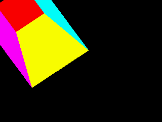<br><sub>Spinning cube — GSX + RTR end-to-end (tb_gsx)</sub></td>
    <td align="center">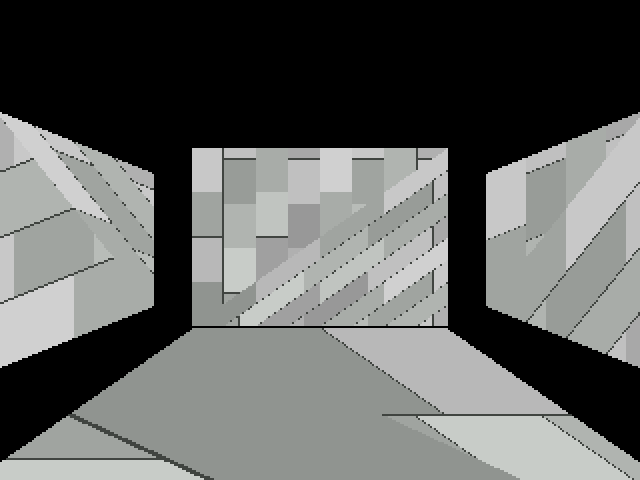<br><sub>Temple scene, orbit frame 0° (tb_anim)</sub></td>
    <td align="center">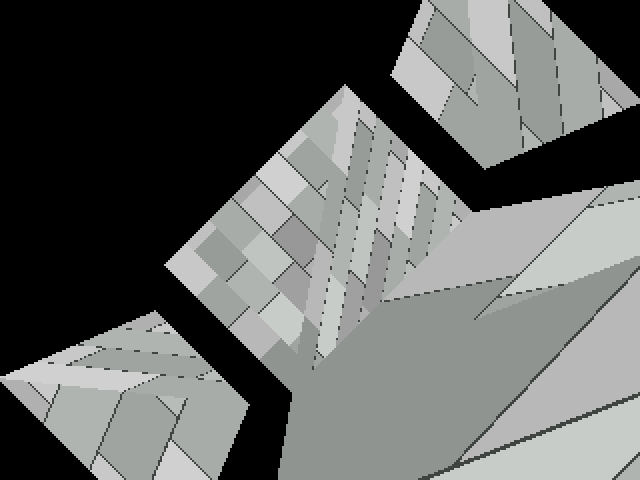<br><sub>Temple scene, orbit frame 45° (tb_anim)</sub></td>
  </tr>
  <tr>
    <td align="center">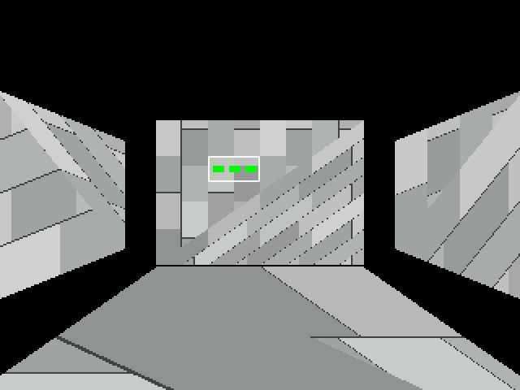<br><sub>Camera fly-through + HUD blit (tb_fly)</sub></td>
    <td align="center">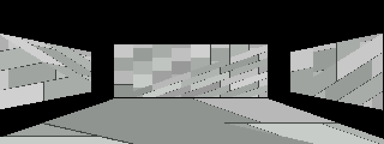<br><sub>Input-driven game loop, frame 0 (tb_input)</sub></td>
    <td align="center">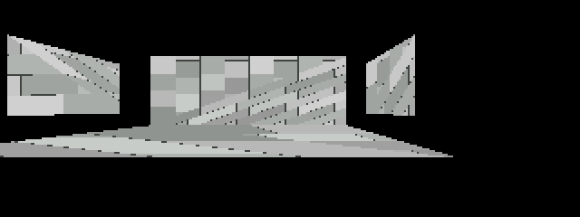<br><sub>Input-driven game loop, frame 10</sub></td>
  </tr>
  <tr>
    <td align="center">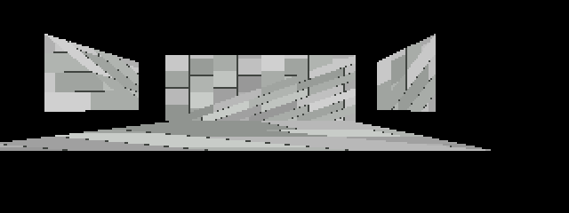<br><sub>Input-driven game loop, frame 24</sub></td>
    <td align="center">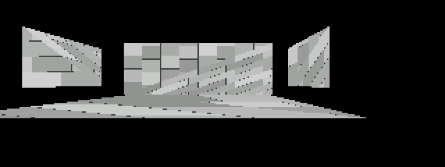<br><sub>Input-driven game loop, frame 30</sub></td>
    <td align="center">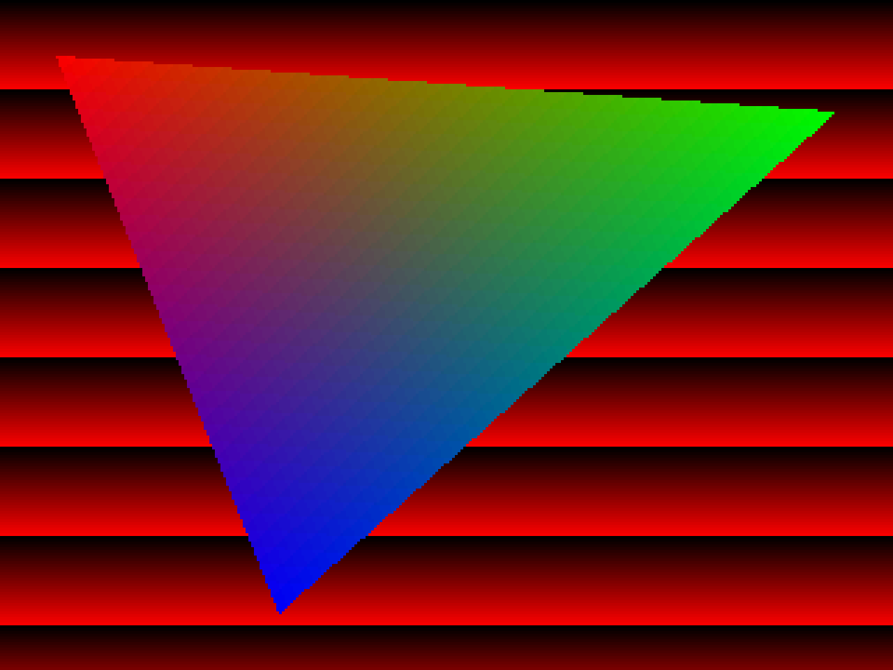<br><sub>Display controller output frame (tb_display)</sub></td>
  </tr>
  <tr>
    <td align="center">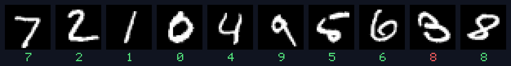<br><sub>MNIST inference on the RTL TU + cores — 98%</sub></td>
    <td align="center"><br><sub>Golden model reference scene</sub></td>
    <td align="center"><br><sub>RTL-rendered scene (bit-exact vs golden)</sub></td>
  </tr>
</table>
</div>

## Architecture & silicon

<div>
<table>
  <tr>
    <td align="center">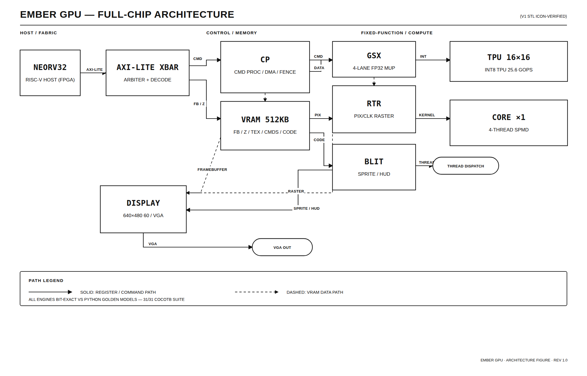<br><sub>EMBER architecture</sub></td>
    <td align="center"><br><sub>Logic die — 8 hardened macros, sky130</sub></td>
    <td align="center">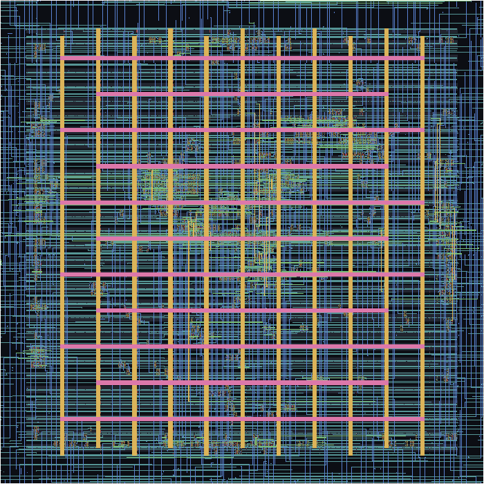<br><sub>Hardened block GDS</sub></td>
  </tr>
  <tr>
    <td align="center">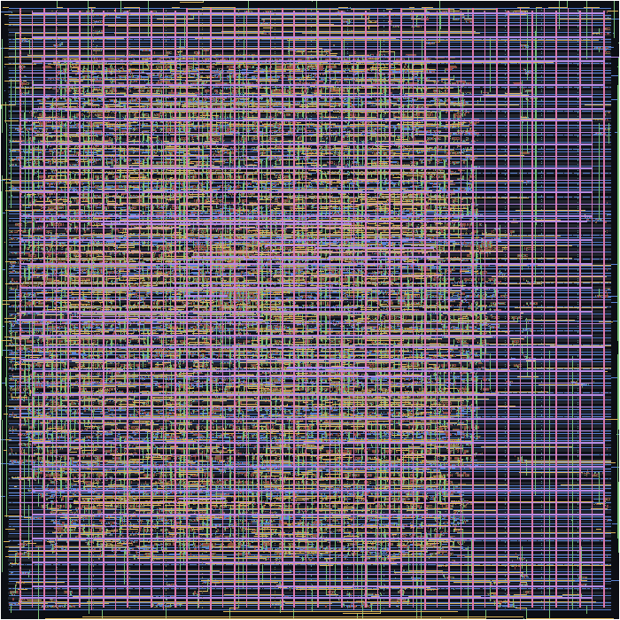<br><sub>Command processor GDS</sub></td>
    <td></td><td></td>
  </tr>
</table>
</div>

---

## Silicon status (sky130)

Real hardening through the open-source flow — 12 block targets, per-block
results auto-collected in [`paper/asic_table.tex`](paper/asic_table.tex):

| Metric | Value |
|---|---|
| Total mapped standard cells | 2,266,911 |
| Blocks hardened | 11 of 12 |
| Blocks with verified GDS | 6 (xbar, display, ram_slave, blit, rtr_setup, cp) |
| Largest block | `rtr_scan` — 1,416,166 cells (hierarchical synth) |
| Clean blocks | routing violations 0, full-layout Magic DRC 0, exported-audit DRC 0 |
| Clock target | 20 ns (50 MHz) |

Blocks in flight: `core`, `tu`, `gsx`, `fpu4`, `rtr_scan`, `rtr_top`, then die
+ pad-ring chip assembly. LVS and chip-level timing sign-off are open and
reported as such — see [`docs/roadmap.md`](docs/roadmap.md) Phase 8 for the
exact evidence bar.

---

## Verification highlights

- **FPU** — 6,720 comparisons / 0 mismatches vs `tools/golden/fpu.py`
- **Raster** — 320×240 per-pixel bit-exact on gradient, perspective-correct
  textured quad, Z-ordering, full ROP chain
- **Tensor unit** — 256×256×256 int8 matmul bit-exact (multi-tile), requant
  path, MNIST conv/dense layers each golden-equal
- **Compute core** — matadd/matmul/divergent/barrier kernels through the real
  software path (assemble → DMA → dispatch → poll → readback)
- **Host firmware** — NEORV32 bare-metal demo matches TB frame 30 on
  10,316/10,316 scene pixels

---

## Repository layout

| Path | Contents |
|---|---|
| [`rtl/`](rtl/) | SystemVerilog RTL — all blocks, package, pad models |
| [`test/`](test/) | cocotb testbenches + Makefiles + golden artifacts |
| [`scripts/`](scripts/) | Build + GDS flow scripts (sv2v/Yosys/OpenROAD/Magic/KLayout) |
| [`tools/`](tools/) | Golden models, assembler, trainer, audits |
| [`build/`](build/) | Flow outputs: block GDS, logs, DRC/audit reports |
| [`checkpoint/`](checkpoint/) | Routed resume checkpoint (`final.odb` / `final.def`) |
| [`paper/`](paper/) | **[ember_paper.pdf](paper/ember_paper.pdf)**, LaTeX sources, figures |
| [`docs/`](docs/) | [Design spec](docs/design-spec.md), [roadmap](docs/roadmap.md), [pinout](docs/chip_pinout.md), [decisions](docs/decisions.md) |
| [`sw/`](sw/) | NEORV32 host firmware (`ember_demo.c`, `cp_driver.h`) |
| [`kernels/`](kernels/) | Compute-core assembly kernels (matmul, pool2d, gamestate, …) |
| [`data/`](data/) | MNIST dataset + trained weights |

---

## Build & test

```bash
# RTL lint (Verilator)
make lint

# Full simulation suite (cocotb + Verilator)
cd test && make

# Individual demos
cd test && make tb_scene   # textured temple scene
cd test && make tb_mnist   # MNIST inference on TU + cores
```

Silicon flow scripts live in `scripts/gds/` and run inside the OpenLane2
container with the volare sky130A PDK.

---

## Author

**Toshal Kumbhar** — RTL, software, verification, golden models, and silicon
flow. See [`paper/ember_paper.pdf`](paper/ember_paper.pdf) for the full write-up.
